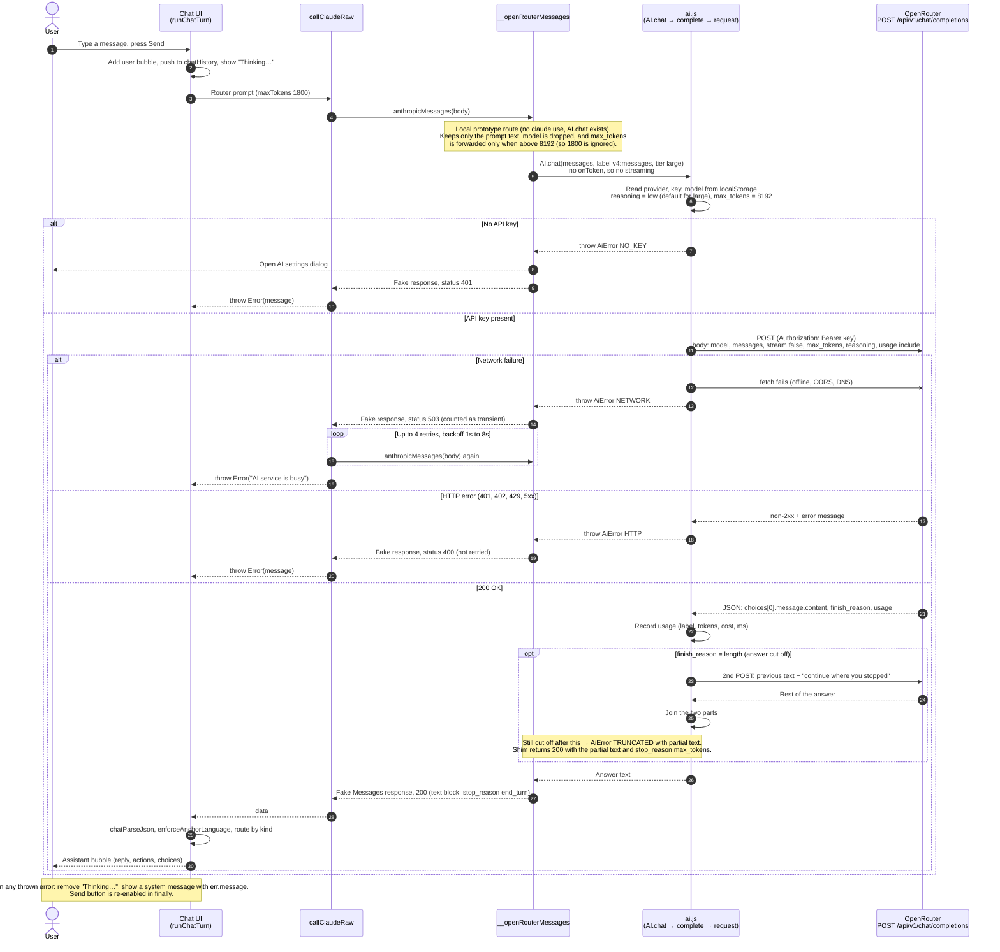
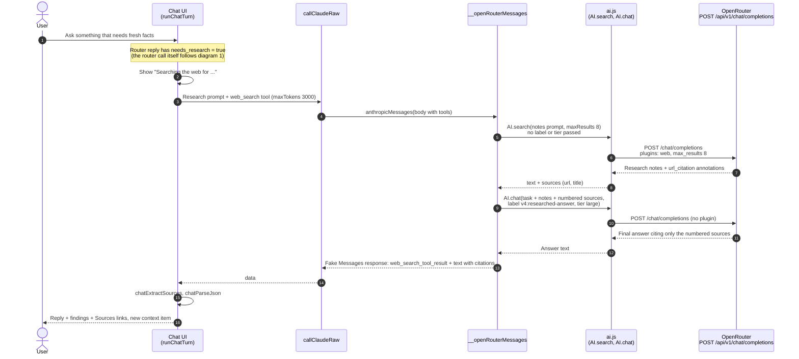

# Chat to OpenRouter: sequence diagrams

Internal document. Describes how a user message in the `entry-v4.html` chat reaches `https://openrouter.ai/api/v1/chat/completions` and how the answer returns.

- **Date:** 2026-11-03
- **Sources:** `entry-v4.html` (chat UI and AI shim), `components/ai.js` (AI harness)
- **Status:** read from code, not run. Diagram syntax was checked by eye only and has not been rendered. Paste into [mermaid.live](https://mermaid.live) or a Markdown preview to confirm.
- **Tags:** 🟢 confirmed in source, 🟡 inference from source, 🔴 gap or conflict

## Summary

The chat does not call OpenRouter directly. A message goes through three layers before the HTTP request is made:

`runChatTurn` → `callClaudeRaw` → `anthropicMessages` / `__openRouterMessages` (shim) → `AI.chat` (`ai.js`) → `POST /chat/completions`

The page speaks the Anthropic Messages shape. The shim converts it to a plain prompt for `AI.chat`, then wraps the answer back into a Messages-shaped response so existing page code keeps working. This route is used only when `window.claude.use()` is missing and `window.AI` exists (the local `file://` prototype).

## Diagram 1: normal chat turn

## Diagram 2: chat turn that needs web research (`needs_research`)

This path calls the endpoint **twice**: first a web search that writes notes, then the final answer written from those notes.

## Code references

| Step | Location |
|---|---|
| Chat turn handler | `entry-v4.html:12497` (`runChatTurn`) |
| Retry and error handling for page calls | `entry-v4.html:11959` (`callClaudeRaw`) |
| Route choice (`claude.use`, AI harness, direct API) | `entry-v4.html:3605` (`anthropicMessages`) |
| Messages-to-`AI.chat` shim | `entry-v4.html:3540` (`__openRouterMessages`) |
| label, tier, maxTokens options | `entry-v4.html:3535` (`__aiOpts`) |
| HTTP request to `/chat/completions` | `components/ai.js:320` (`request`) |
| Web search request with `plugins: web` | `components/ai.js:734` (`searchOpenRouter`) |
| Continuation after a cut-off answer | `components/ai.js:551` (`complete`) |

## Findings

- 🟢 The chat does not stream. The shim passes no `onToken`, so `AI.chat` sends `stream: false` (`ai.js:297`), although `ai.js` supports streaming.
- 🟢 The chat's own `maxTokens` (1800, 3000) never reaches `ai.js`. `__aiOpts` forwards `max_tokens` only above 8192, so the default 8192 applies.
- 🟢 The model id hardcoded in `callClaudeRaw` (`claude-sonnet-4-6`) is dropped by the shim. The model comes from AI settings.
- 🟢 The shim maps errors to fake HTTP statuses: `NO_KEY` → 401, `NETWORK` → 503, everything else → 400 (`entry-v4.html:3601`). `AiError` has no status field (`ai.js:55`).
- 🟡 Consequence: a 429 or 5xx from OpenRouter becomes 400, so `callClaudeRaw` does not retry it (it retries only 429, 5xx and `overloaded_error`). Network failures are retried up to 4 times, while CLAUDE.md says up to 3. Not verified by running.
- 🟡 On `TRUNCATED`, `callClaudeRaw` does not check `stop_reason`, so cut-off JSON goes to `chatParseJson`. It likely fails to parse and shows "Could not read the response". `enforceAnchorLanguage` was not read to confirm.
- 🔴 Conflict with CLAUDE.md: every call through `callClaudeRaw` shares the label `v4:messages` and tier `large`. The usage log cannot separate the router call from other tasks, and a classify task like the router should start at `small`.
- 🔴 Conflict with CLAUDE.md: `AI.search` in the shim passes no label or tier (`entry-v4.html:3561`), so `ai.js` falls back to `callerLabel()`.

## Not covered

- Other `runChatTurn` branches: `explore_more`, `presentation`, `decision_help`. Each makes further calls.
- Other providers (Claude API, LM Studio) and the `claude.use()` and `__directMessages` routes.
- Diagram 2 assumes the search provider is OpenRouter. With Tavily or Claude web search, `AI.search` takes another path. With search set to `off`, `AI.search` returns empty and the shim continues with "(no notes)" (`ai.js:620`, `entry-v4.html:3572`). Read from code, not run.

## Open questions

1. Should the retry mapping in the shim be fixed so 429 and 5xx are retried, and the retry count aligned with CLAUDE.md (3, not 4)?
2. Should the router call and the research call get their own labels, and should the router move to tier `small`?
3. Should the shim surface `stop_reason: max_tokens` to `callClaudeRaw`, so a cut-off answer shows a clear error instead of a parse failure?
